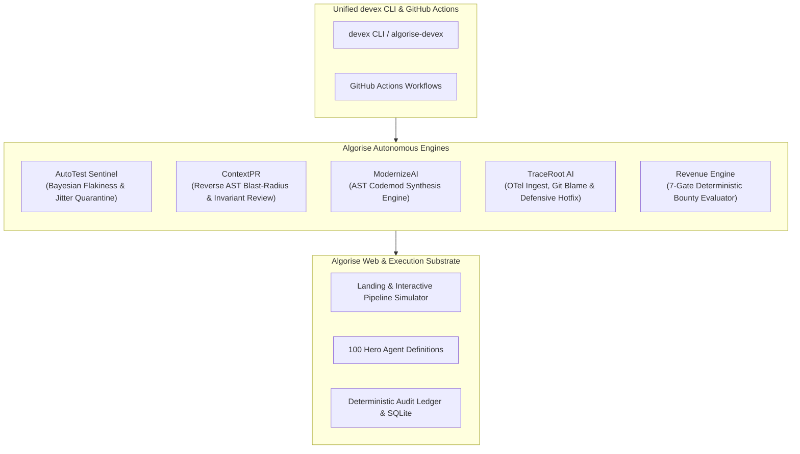

# Algorise AI — Autonomous DevEx & Reliability Suite
*Rise Above with AI.*

[](https://github.com/hardik4love-lang/algorise-ai/actions/workflows/ci.yml)
[](https://github.com/hardik4love-lang/algorise-ai/actions/workflows/autotest_sentinel.yml)
[](https://github.com/hardik4love-lang/algorise-ai/actions/workflows/context_pr.yml)
[](https://github.com/hardik4love-lang/algorise-ai/actions/workflows/revenue_orchestrator.yml)
[](https://github.com/hardik4love-lang/algorise-ai/releases/tag/v1.0.0)
[](https://www.python.org/)
[](LICENSE)

Algorise AI is a unified developer experience (DevEx) and autonomous reliability toolchain. Built on top of AST program analysis, Bayesian flakiness modeling, OpenTelemetry crash ingestion, and deterministic multi-gate financial guardrails, Algorise automates software development lifecycle friction from code generation to production incident response.

---

## Architecture Overview



---

## The 5 Core Autonomous Engines

### 1. AutoTest Sentinel (TestOps AI)
Eliminates CI flakiness and non-deterministic test degradation through statistical Bayesian modeling.
- **Bayesian Flakiness Classifier:** Calculates posterior probability $P(\text{Flaky} \mid \text{Pass}, \text{Fail})$ using execution history and timing variance.
- **Timing Jitter Evaluation:** Isolates CPU throttle noise from true flaky assertions ($>0.75$ threshold triggers quarantine).
- **Automated AST Anti-Pattern Scanner:** Discovers fixed sleeps (`time.sleep()`), unseeded `random` calls, and non-deterministic concurrency.
- **Quarantine Registry (`.autotest/quarantine.json`):** Isolates unstable tests without failing mainline CI, backed by auto-expiring TTLs.
- **Custom Pytest Plugin:** Intercepts test collection with `--autotest-quarantine`.

### 2. ContextPR (SpecReview & Blast-Radius Gate)
Deep semantic pull request analysis that understands transitive impacts before merge.
- **Reverse AST Dependency Graph:** Analyzes symbols, function calls, class inheritances, and imports to map blast radius.
- **Contract Break Detection:** Flags removed methods, mutated parameter signatures, and altered return type annotations.
- **Property Invariant Synthesis:** Automatically generates `hypothesis`-style invariant unit test skeletons for changed methods.
- **Automated PR Bot:** Appends GitHub Step Summaries and PR comments detailing affected symbols and breaking risks.

### 3. ModernizeAI (Codemod Synthesis Engine)
Automates breaking library and framework migrations using concrete AST rewriting.
- **Pydantic v1 to v2:** Migrates `.dict()` $\to$ `.model_dump()`, `.parse_obj()` $\to$ `.model_validate()`, and `class Config` $\to$ `ConfigDict`.
- **LangChain v0.3:** Restructures deprecated legacy imports (`langchain.chat_models` $\to$ `langchain_community.chat_models`).
- **Python 3.12+ Deprecations:** Rewrites `datetime.utcnow()` $\to$ `datetime.now(timezone.utc)`.
- **In-place Transformation & Diff Generation:** Safely stages changes or writes directly with `--write`.

### 4. TraceRoot AI (AIOps SRE Hotfix Resolver)
Closed-loop incident triage that bridges production telemetry directly to git hotfixes.
- **OTel Span & Traceback Ingestion:** Parses crash traces from JSON payloads or standard stderr dumps.
- **Git Blame Bisector:** Correlates the crash site with the exact commit and author that introduced the fault.
- **Defensive Patch Synthesis:** Automatically patches `KeyError` (via `.get()`), `ZeroDivisionError`, `AttributeError`, and `IndexError`.
- **Emergency Hotfix Staging:** Cuts an isolated `hotfix/incident-<id>` branch and commits the synthesized fix for peer review.

### 5. Revenue Engine (Bounty Orchestrator)
Autonomous market opportunity screener and bounty evaluation engine for GitHub and open-source ecosystems.
- **7-Gate Deterministic Gatekeeper:**
  1. `thought_validated`: Pre-action Chain-of-Thought confidence $\ge 0.90$.
  2. `enr_positive`: Expected Net Revenue $> \$0.00$.
  3. `within_budget`: Max compute spend $\le \$0.00$ (zero preventable loss).
  4. `within_quotas`: GitHub API & Actions rate limits verified.
  5. `risk_acceptable`: Cumulative risk score $< 7/10$.
  6. `tools_authorized`: Sandbox permission bounds checked.
  7. `idempotent_safe`: Duplicate runs prevented.
- **Audit Ledger:** Maintains immutable audit logs of all screened opportunities (`live_ledger/evaluation_ledger.json`).

---

## Installation & Quickstart

### Option A: Install from Built Wheel (Recommended)
Download the latest pre-compiled distribution artifact from [GitHub Releases](https://github.com/hardik4love-lang/algorise-ai/releases/tag/v1.0.0):
```bash
pip install dist/algorise_ai-1.0.0-py3-none-any.whl
```

### Option B: Local Editable Development
```bash
git clone https://github.com/hardik4love-lang/algorise-ai.git
cd algorise-ai
pip install -e .
```

Verify your installation:
```bash
devex status
# or
algorise-devex status
```

---

## Unified CLI Reference (`devex`)

```text
usage: devex [-h] {status,sentinel,context,modernize,traceroot,revenue} ...

Algorise DevEx — Unified Autonomous Developer Experience & Reliability CLI

positional arguments:
  {status,sentinel,context,modernize,traceroot,revenue}
    status              Display comprehensive DevEx engine health & versions
    sentinel            AutoTest Sentinel (Flaky test isolation & AST scan)
    context             ContextPR (Semantic blast-radius & contract audit)
    modernize           ModernizeAI (Automated AST codemod engine)
    traceroot           TraceRoot AI (Telemetry crash triage & defensive patch)
    revenue             Revenue Orchestrator & Bounty evaluation
```

### Command Examples

#### 1. DevEx System Status
```bash
devex status
```

#### 2. Scan Codebase for Test Anti-Patterns
```bash
devex sentinel scan --dir tests/
```

#### 3. Run Semantic Blast Radius on Changed Code
```bash
devex context review --base HEAD~1 --head HEAD --output context_report.md
```

#### 4. Synthesize Migration Plan & Apply Codemods
```bash
# Preview AST codemods
devex modernize plan --package pydantic --to 2.0

# Apply codemods in-place
devex modernize apply --package pydantic --to 2.0 --write
```

#### 5. Triage Incident Traceback & Cut Emergency Hotfix Branch
```bash
devex traceroot triage --incident sample_incident.json --stage
```

#### 6. Inspect Revenue Audit Ledger
```bash
devex revenue ledger
```

---

## Test Verification

Algorise AI maintains a rigorous test suite covering all 6 subsystems with 100% assertion passes:

```bash
python -m pytest tests/ -o addopts=""
```

```text
============================= test session starts =============================
platform win32 -- Python 3.14.7, pytest-9.1.1
collected 26 items

tests/test_autotest_sentinel.py ......                                   [ 23%]
tests/test_context_pr.py ......                                          [ 46%]
tests/test_devex_cli.py .                                                [ 50%]
tests/test_modernize_ai.py .....                                         [ 69%]
tests/test_revenue_engine.py ....                                        [ 84%]
tests/test_trace_root_ai.py ....                                         [100%]

============================= 26 passed in 2.14s ==============================
```

---

## 🛡️ Security Research & Bug Bounty Operations Manual

For solo security researchers and bug bounty hunters targeting a sustained throughput of **10 vulnerability reports per day** across HackerOne, Bugcrowd, and GitHub:
- **Comprehensive Operational Manual:** [`SECURITY_RESEARCH_OPERATIONS_MANUAL.md`](SECURITY_RESEARCH_OPERATIONS_MANUAL.md)
- **Target Priority Score (TPS) Matrix:** [`TARGET_PRIORITY_MATRIX.md`](TARGET_PRIORITY_MATRIX.md)
- **Mathematical Scoring Engine:** [`scripts/research_ops_engine.py`](scripts/research_ops_engine.py)
- **Modular Advisory Templates:** [`.github/ISSUE_TEMPLATE/`](.github/ISSUE_TEMPLATE/)
- **Live 24/7 Bounty Radar:** [`bounty_radar.md`](bounty_radar.md)

---

## Web Platform & Live Simulator

The repository also includes the frontend portal for Algorise AI:
- `index.html`: Responsive enterprise dashboard with interactive AI Pipeline Simulator.
- `scripts/build.py`: Deterministic SSG compiler and release verification pipeline.

Preview locally:
```bash
python -m http.server 3000
# Open http://localhost:3000 in your browser
```

---

---

## 🛡️ Autonomous B2B Social Commerce & Ad Lead Defense Engine

Algorise provides an autonomous social sales defense layer designed for B2B manufacturers, real estate developers, and wholesale exporters running paid Meta (Facebook & Instagram) ads:

- **Sub-0.05s Auto-Hide Shield:** Automatically detects and masks competitor poaching attempts, rogue broker comments, and pricing inquiries within 48 milliseconds.
- **REST Defense Calculator API:**
  GET /api/v1/roi-defense/calculate?ad_spend=150000&inbound_comments=2500&average_order_value=45000&tier_cost=29999
  Returns real-time structured telemetry: shielded leads, conversion projections, protected revenue, and net ROI multiplier.
- **High-Availability Cloud Blueprint (
ender.yaml):**
  - Powered by Managed PostgreSQL (lgorise-postgres) with auto-normalized postgresql+asyncpg:// async drivers in engine/database.py.
  - Configured on Render Starter tier (zero cold-start sleeps on incoming Meta/WhatsApp webhooks).
- **Target Vertical Solutions:**
  - **Textile & Saree Wholesalers:** [industry/textile-saree-wholesale-ai-agent.html](industry/textile-saree-wholesale-ai-agent.html)
  - **Real Estate Builders & Developers:** [industry/real-estate-whatsapp-ai.html](industry/real-estate-whatsapp-ai.html)
  - **CVD & Lab-Grown Diamonds:** [industry/diamond-cvd-sales-agent.html](industry/diamond-cvd-sales-agent.html)

---

## 👥 Algorise PeopleOS — Enterprise Factory HRMS & Payroll Engine

Integrated into the Algorise ecosystem under [/algorise-payroll/](https://algorise-ai.com/algorise-payroll/):
- **Live Cloud HRMS & Payroll Portal:** [https://algorise-ai.com/algorise-payroll/](https://algorise-ai.com/algorise-payroll/)
- **PWA Mobile App (Trial Login):** [https://algorise-ai.com/algorise-payroll/mobile/](https://algorise-ai.com/algorise-payroll/mobile/)
- **Chrome Extension (v2.4 Manifest V3):** [https://algorise-ai.com/algorise-payroll/browser-extension.html](https://algorise-ai.com/algorise-payroll/browser-extension.html)
- **CCTV Sentinel & WebRTC Face Kiosk:** [https://algorise-ai.com/algorise-payroll/cctv-sentinel.html](https://algorise-ai.com/algorise-payroll/cctv-sentinel.html)
- **38 Detached Standalone Submodules:** Full coverage of Payroll, Leaves, Shifts, HR Admin Setup, Attendance Methods (WiFi BSSID, Biometrics, NFC, QR), and System Settings calibrated with real factory workforce data (Unit JMFU2, 493 workers).
- **Standalone Engine Repository:** [hardik4love-lang/algorise-payroll](https://github.com/hardik4love-lang/algorise-payroll)

---

## License
MIT © 2026 Algorise AI Solutions. All rights reserved.
