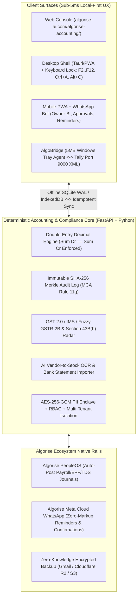

# Algorise BooksOS (`AlgoBooks` + `AlgoBridge`) — Master Product, Technical & Client-Capture Blueprint
## Building a Superior, AI-Native Replacement for Tally.ERP 9 & TallyPrime on `algorise-ai.com`

**Document ID:** ALGO-ACC-BLUEPRINT-2026-V1  
**Target Platform:** `https://algorise-ai.com/algorise-accounting/` (`AlgoBooks`, `AlgoBridge`, `AlgoAudit`)  
**Ecosystem Integration:** Native sibling to **Algorise PeopleOS** (`AlgoRoll` + `AlgoTrack`) and **Algorise B2B LeadShield / WhatsApp Engine**  
**Research Basis:** Cross-platform synthesis of Internet forums (Reddit, Quora, G2, Tally Partner discussions), YouTube creator/CA troubleshooting content, competitive benchmarking (Tally.ERP 9, TallyPrime 3.0–7.2, Zoho Books, HisabKitab, Vyapar, MyBillBook, Busy, Swipe, Suvit, Biz Analyst, CredFlow), and codebase audit of `algorise-ai`.

---

## Executive Summary: Why Tally Still Owns 75%+ of Indian SMEs — And How We Break Its Monopoly

Tally.ERP 9 (now End-of-Support) and its successor TallyPrime command massive loyalty among Indian SMEs and Chartered Accountants (CAs) despite feeling like a DOS-era desktop application. Challengers like **Zoho Books, Vyapar, MyBillBook, and Swipe** have repeatedly failed to capture Tally's core power-user and CA base because they solve *owner convenience* while breaking *accountant speed and compliance depth*.

To steal Tally's existing client base systematically—starting from India's textile, diamond, trading, and manufacturing hubs (e.g., Surat, Ahmedabad, Mumbai, Tiruppur, Ludhiana) and scaling globally—**Algorise BooksOS** follows one core architectural law:

> **Keep 100% of Tally's Keyboard Muscle Memory & Double-Entry Control. Eliminate 100% of Its DOS-Era File Locks, Cloud Paywalls, Manual Entry, and Compliance Blind Spots.**

---

## Part 1: Deep Internet & YouTube Forensics (Validated Pain Points)

### 1.1 The 12 Structural Failures of Tally.ERP 9 (and Persistent Gaps in TallyPrime)

Across thousands of YouTube troubleshooting tutorials, CA complaints, and SMB reviews, users repeatedly hit the exact same breaking points:

| # | Pain Category | Tally.ERP 9 Reality | Even in TallyPrime 5.x–7.2 (2025–2026) | Algorise BooksOS Solution |
| :--- | :--- | :--- | :--- | :--- |
| **1** | **DOS-Lineage Flat-File Architecture** | Proprietary `.900` / `.tsf` files (`TranMgr.900`, `Company.900`); single-threaded CPU execution; degrades badly as data grows. | Moved to `.1800` block format, still desktop/file-system bound; data rewrites & company splitting remain painful. | **PostgreSQL 16 ACID Cloud + Local SQLite WAL (`<5ms` UI write)**; multi-core parallel reporting across 10M+ vouchers with zero file splits. |
| **2** | **Data Corruption & LAN Freezes** | Abrupt power cuts, Wi-Fi drops, or Windows Defender real-time scans lock `.tsf` files and corrupt `.900` headers ("Rewrite/Repair" risks silent data loss). | Requires dedicated wired server, AV exclusions, or costly **TallyPrime Server (₹2.7L + GST)** to prevent multi-user LAN locks. | **Zero-Corruption Transactional WAL + CRDT Offline Sync** + automated Zero-Knowledge AES-256-GCM backups (Gmail/R2/S3). |
| **3** | **Costly, Clunky Cloud & Multi-User Access** | Single-PC Silver (₹22.5k) vs LAN Gold (₹67.5k). Remote access requires RDP/TeamViewer/VPS (`₹200–₹750/user/mo`) + TVU fees. | Official AWS/cloud hosting costs extra on top of license + TSS; no true browser-first or Mac/Linux native parity. | **True Cross-Platform Web + PWA + Tauri Desktop (Win/Mac/Linux) + Mobile** included in flat transparent pricing. |
| **4** | **TSS Renewal "Tax" & Lock-In** | Annual TSS (`₹4,500` Silver / `₹13,500` Gold + GST) becomes mandatory to get GST updates; legacy ERP 9 users lose all statutory patches. | Connected GST, IMS, e-Invoicing, WhatsApp, and TallyDrive backups **stop working if TSS expires**. | **Always-current cloud statutory rules** with zero artificial feature kill-switches or upgrade fees. |
| **5** | **MCA Audit Trail (Rule 11(g)) Deficit** | Native Tally.ERP 9 lacks immutable version history ("Tally Audit" only shows last editor, not before/after diff or deletions). | Edit Log requires specific version migration; migrating old `.900` companies with custom TDLs triggers mismatch errors. | **SHA-256 Merkle-Chained Immutable Edit Log** built into every row from Day 1 — cannot be disabled, cryptographically verifiable by CAs. |
| **6** | **GSTR-2B / IMS & Strict Matching Bugs** | No native automated GSTR-2B JSON portal sync; users export Excel registers and rely on third-party tools. | Built-in 2B/IMS lags on high B2B volume; strict matching fails on `INV-001` vs `001` or `₹0.50` rounding differences. | **Fuzzy AI GSTR-2B + IMS Reconciler** tolerating prefix/format/rounding diffs while isolating genuine ITC risk before filing. |
| **7** | **Section 43B(h) MSME Tax Trap** | Zero native tracking for Udyam Micro/Small 15-day / 45-day payment deadlines; businesses face surprise 30% tax disallowances. | Requires manual ledger tagging and proactive checking of exception reports. | **Automated 43B(h) Disallowance Radar** with auto-alerts at Day 10/30/40 + 1-click priority NEFT/IMPS batch payment. |
| **8** | **Manual Data Entry & OCR Limitations** | Zero OCR. Accountants manually punch purchase bills and PDF bank statements line by line. | `Docs by Ira` extracts financial totals, **but struggles to map vendor items to internal inventory masters** automatically. | **Self-Learning Vendor-to-Master AI Mapper** + native Bank PDF/CSV parser that remembers SKU/HSN mappings per supplier. |
| **9** | **Stacked Third-Party SaaS Costs** | Needs Biz Analyst (`₹3k+/yr`) for mobile, CredFlow (`₹12k+/yr`) for reminders, Suvit (`₹10k+/yr`) for Excel/PDF import. | Native WhatsApp & PrimeBanking exist only on active TSS + specific partner banks. | **All-in-One Native Stack**: Mobile BI + WhatsApp Ledger Recovery (Zero Meta Markup!) + Excel/PDF/Bank Importer included. |
| **10** | **TDL Customization Fragility** | Simple invoice layout tweaks or textile bale/broker fields require hiring proprietary TDL developers (`₹5k–₹50k+`). | Major releases (3.0 -> 6.0 -> 7.x) frequently break legacy `.tcp`/`.txt` TDL add-ons. | **No-Code Visual Invoice & Voucher Builder + Vertical Industry Packs** (Textile, Diamond, Pharma, Manufacturing). |
| **11** | **Steep Non-Accountant Learning Curve** | Rigid keyboard-only flows overwhelm founders, warehouse staff, and Gen-Z sales reps. | Improved "Go To" (`Alt+G`), but core ledger UX still feels alien to non-CAs. | **Dual-Mode UI**: *Tally-Parity Keyboard Mode* for accountants + *Modern Visual Mode* for owners & billing staff. |
| **12** | **Disconnected Payroll & Sales Silos** | Payroll inside Tally is rigid; requires manual salary journal exports and zero attendance verification. | Same manual bridge between HR/attendance, CRM orders, and accounting ledgers. | **1-Click Integration with `Algorise PeopleOS` (AlgoRoll) & `Algorise WhatsApp Sales`** — auto-posting salary & ad-order journals. |

---

### 1.2 Why Competitors Fail to Steal Tally's Clients (The "Competitor Graveyard")

Our research uncovered **three fatal traps** that cause Indian SMEs to try Zoho Books, Vyapar, or MyBillBook — and then **crawl back to Tally before March 31st audits**:

1. **The "Black Box" Trap (Accountant Rejection):** Mobile billing apps hide double-entry debit/credit mechanics to look simple. When a CA needs to pass complex year-end adjustments (deferred tax, RCM, TDS 194Q vs 206C(1H), opening stock valuation splits, multi-godown transfers), they cannot drill down cleanly and demand the client switch back to Tally.
2. **The Browser Shortcut Conflict (Speed Death):** Experienced Tally operators type vouchers without touching the mouse (`F8` Sales, `Alt+C` inline ledger creation, `Ctrl+A` instant save, `F5` Payment, `F12` config). Standard web apps lose `Ctrl+W` (closes browser tab), `Ctrl+N` (opens new window), `F5` (reloads page!), `F11` (fullscreen), and `F12` (DevTools) — cutting operator entry speed by **50–70%**.
3. **The CA Multi-Portal Friction:** A CA firm managing 60 SME clients refuses to learn 6 different web dashboards. Tally is their universal workbench. If you don't build a **unified CA Multi-Tenant Command Center**, CAs will actively block your adoption!

---

## Part 2: Foolproof Product Architecture (`Algorise BooksOS`)

### 2.1 Solving the "DOS-Speed on Modern Web" Challenge
1. **Tally-Parity Keyboard Engine (`ShortcutRouter`):**
   - Full shortcut parity out of the box:
     - `F2`: Change Voucher Date | `Alt+F2`: Change Financial Period
     - `F4`: Contra | `F5`: Payment | `F6`: Receipt | `F7`: Journal | `F8`: Sales | `F9`: Purchase | `F10`: Credit/Debit Note & Job Work
     - `Alt+C`: **Inline Master Creation** inside any ledger/item dropdown without losing voucher state!
     - `Alt+G`: **Go To / SmartFind Command Palette** (jump to Day Book, Trial Balance, P&L, Stock Summary, GSTR-2B, or any Party Ledger in 2 keystrokes)
     - `Ctrl+A`: **Instant Save / Accept** anywhere | `Ctrl+T`: **Mark Post-Dated Cheque (PDC)** | `Esc`: Clean hierarchical back navigation
   - **Zero Browser Clash:** Wrapped in **Tauri Desktop (`tauri-plugin-prevent-default`)** for Windows/Mac power operators + `navigator.keyboard.lock()` in Fullscreen PWA mode + `e.preventDefault()` interception for `F2–F12`, `Alt+C/G/D`, `Ctrl+A/T`.
2. **Dual Visual Skins (1 Click Switch):**
   - **Cosmic Dark Executive Mode:** Native `algorise-ai.com` aesthetic (`#03050C`, `#00F2FE`, `#10B981`) for owners, founders, and sales teams.
   - **Classic Tally High-Contrast Mode:** Crisp tabular grid, high-density monospace numbers (`JetBrains Mono`, `tabular-nums`), zero distracting animations — built specifically so veteran Tally accountants feel at home in **60 seconds**.
3. **Local-First Offline Guarantee:**
   - Every keystroke writes to local IndexedDB / SQLite WAL in `<5ms` — works seamlessly during industrial power/broadband outages, syncing deterministically via idempotency keys to PostgreSQL 16 when online.

### 2.2 Financial & Statutory Correctness by Construction
- **Exact `Decimal` Arithmetic:** Zero IEEE-754 floating-point drift; every voucher enforces `sum(debits) == sum(credits)` and balanced rounding (`Rounding Off` ledger auto-allocation capped & audited).
- **MCA Rule 11(g) Non-Disableable Merkle Audit Trail:**
  - Every `CREATE`, `ALTER`, `CANCEL`, or `REVERSE` writes an append-only event record:
    $$\text{Block\_Hash} = \text{SHA-256}(\text{Prev\_Hash} \parallel \text{Timestamp\_UTC} \parallel \text{Actor\_ID} \parallel \text{Company\_ID} \parallel \text{Action} \parallel \text{Before\_JSON} \parallel \text{After\_JSON})$$
  - Database `DELETE` on posted financial vouchers is disabled at both API and DB trigger levels. Cancellations preserve original entry + generate linked audit trail proof.
- **Zero-Trust PII & DPDP Act 2023:**
  - Reuses `algorise-payroll`'s `PIIEncryptor` (`AES-256-GCM` with 96-bit nonces) for Bank Accounts, PAN, Aadhaar, Udyam numbers, and GST portal tokens.

---

## Part 3: The 5 Killer Features That Win Tally Clients Overnight

### 3.1 `AlgoBridge` — 1-Click Lossless Tally.ERP 9 / TallyPrime Migration & Shadow Sync
Instead of asking clients to export messy CSVs (where bill-by-bill aging and opening stock break), `AlgoBridge` connects directly to the client's open Tally instance on **`http://localhost:9000`** (Tally's native XML HTTP Server):
1. **Staged Dependency-Safe Ingestion:**
   - Stage 1: Company Profile, Financial Year, Units of Measure, Godowns, Cost Centres.
   - Stage 2: Account Groups & Party/Tax Ledgers with **exact `<BILLALLOCATIONS.LIST>` bill-by-bill breakups** and Dr/Cr sign preservation (`Assets +Dr/-Cr`, `Liabilities -Dr/+Cr`).
   - Stage 3: Stock Items with `<BATCHALLOCATIONS.LIST>` (Godown, Batch, Opening Qty, Opening Rate, Opening Value) so Balance Sheet inventory matches to the rupee.
   - Stage 4: Historical Vouchers + **Automated Trial Balance Parity Gate** (computes Net Dr/Cr & Closing Stock post-import and verifies `0.00` variance against Tally!).
2. **30-Day Shadow Parallel Mode:** Keeps running side-by-side sync (`localhost:9000` <-> `AlgoBooks Cloud`) for 30 days so conservative owners and CAs verify every report before shutting down Tally!

### 3.2 Section 43B(h) MSME Disallowance Shield
- Automatically tags Micro & Small suppliers via Udyam verification.
- Tracks 15-day (no written agreement) and 45-day (written agreement) statutory clocks on every purchase bill.
- Fires **Day-30 Warning** and **Day-40 Critical Alert** via WhatsApp/Email to prevent year-end Income Tax profit add-backs.

### 3.3 Fuzzy AI GSTR-2B / IMS & Bank Reconciliation
- **Smart Tolerance Matching:** Auto-pairs `TI/26-27/045` with `045`, ignores prefix/whitespace formatting, flags `₹1–₹5` rounding variance cleanly, and sorts discrepancies into *Matched*, *Value Mismatch*, *Missing in Books*, and *Missing in GSTR-2B (ITC Hold)*.
- **Vendor-Item Memory Bank:** When parsing supplier PDF/WhatsApp purchase invoices, `AlgoBooks` learns that Vendor A's `"60gm Dola Grey Lot"` maps to your internal Stock Item `"Dola Silk Grey 60G"` + HSN `5407` + `5% GST` — eliminating `Docs by Ira`'s biggest manual mapping flaw.

### 3.4 WhatsApp-First Receivables & Balance Confirmation (Zero Meta Markup)
- Leverages `algorise-ai`'s existing zero-markup Meta Cloud API & Gujarati/Hindi NLP:
  - **Automated Aging Nudges:** Polite multilingual WhatsApp reminders at Due+3, Due+10, Due+20 with attached PDF invoice + instant UPI/NEFT payment link.
  - **1-Click Annual/Quarterly Balance Confirmation:** Sends party ledger summary on WhatsApp; buyer replies `"CONFIRM"` or `"DISPUTE <reason>"` -> cryptographically logged for CA statutory audit!

### 3.5 Vertical-Native Packs (Zero TDL Developer Fees)
- **Surat Textile & Job-Work Pack:** Grey-to-Dyeing/Printing Job Work Challans, Taka/Meter/Kg dual-unit tracking, Shrinkage/Process Loss %, Broker/Adat Commission auto-accrual, PDC Register.
- **CVD & Diamond Trade Pack:** Carat / Cent / Piece inventory, Jangad (Approval Memo) tracking, USD/INR multi-currency FX revaluation.
- **Native `Algorise PeopleOS` Sync:** 1-click posting of monthly `AlgoRoll` salary sheets, EPF/ESIC employer liabilities, PT, and TDS 192B journals directly into `AlgoBooks`.

---

## Part 4: "Steal All Tally Clients" — Go-To-Market, Pricing & Funnel Strategy

### 4.1 Pricing Destruction: Eliminating Tally's "Stacked Fee Trap"

| Cost Component (5-User SME, Year 1) | TallyPrime Gold + Ecosystem | **Algorise BooksOS** |
| :--- | :--- | :--- |
| **Base Software / Multi-User** | ₹67,500 + GST (Gold) or ₹24,300/yr Rental | **₹5,999 / year** (All-Inclusive Growth Plan) |
| **Annual Compliance / TSS** | ₹13,500 + GST/yr (Gold TSS from Yr 2) | **₹0** (Always Included) |
| **Cloud / Remote Access (5 users)** | ₹24,000–₹45,000/yr (VPS/AWS + TVU) | **₹0** (Native Web + Mobile + Desktop) |
| **Mobile BI + WhatsApp Recovery** | ₹15,000+/yr (Biz Analyst + CredFlow) | **₹0** (Included; Direct Meta API) |
| **Excel / PDF Auto-Importer** | ₹10,000+/yr (Suvit / TDL utilities) | **₹0** (Built-in OCR + XML Bridge) |
| **Total Year-1 Outlay (5 Users)** | **~₹1,16,500 – ₹1,37,500+ / yr** | **₹5,999 – ₹14,999 / yr (85–90% Savings!)** |

**Recommended Tier Ladder:**
1. **Starter (`₹2,499/yr`):** 1 Company, 2 Users, Full Tally Keyboard Engine, GST/e-Invoice, Merkle Audit Trail, WhatsApp PDF Dispatch, 1-Click Tally XML Importer.
2. **Growth Multi-Branch (`₹5,999/yr`):** 5 Companies, 10 Users, `AlgoBridge` Real-Time Sync, Fuzzy GSTR-2B/IMS, Section 43B(h) Radar, OCR Bank/Purchase Auto-Entry, WhatsApp Payment Recovery.
3. **Enterprise + Algorise OS Bundle (`₹14,999/yr`):** Unlimited Users/Branches, Textile/Diamond/Manufacturing Vertical Packs, Native `PeopleOS` (`AlgoRoll`) + `LeadShield` CRM Sync, Dedicated Encrypted Cloud Backup + SLA.

### 4.2 The "CA Trojan Horse" Acquisition Engine
* **Why CAs Decide:** 70%+ of SMEs will not switch accounting software unless their Chartered Accountant approves.
* **The Offer:**
  1. **Free Multi-Tenant CA Super-Console:** CAs manage 100+ clients from one login with bulk GSTR-1/2B/3B review, 1-click Schedule III Balance Sheet & Form 3CD exports, and verified MCA Rule 11(g) Merkle Edit Logs.
  2. **25%–30% Lifetime Recurring Revenue Share:** Every SME onboarded by a CA generates passive recurring income for the CA firm—turning CAs from Tally gatekeepers into Algorise's unpaid sales force!
  3. **Target:** 30 mid-sized CA partners (averaging 40 SMEs each) = **1,200 SME pipeline** in 90 days.

### 4.3 The "7-Day Shadow Risk Audit" Closer
1. Prospect installs `AlgoBridge` (takes 3 minutes; read-only XML query against `localhost:9000` on their existing Tally.ERP 9).
2. `AlgoBooks` generates an automated **"Tally Risk & Cash Recovery Report"** showing:
   - Uncollected overdue receivables (recoverable via WhatsApp pay links)
   - At-risk Input Tax Credit in GSTR-2B mismatches
   - Section 43B(h) MSME 45-day tax disallowance exposure
   - MCA Rule 11(g) Audit Trail compliance gaps (especially fatal on Tally.ERP 9!)
3. Offer **30-Day Parallel Run**: zero downtime, zero data risk, automatic conversion once Month-1 Trial Balance matches to `0.00`.

### 4.4 High-Intent YouTube & SEO Hijack Funnel
* **Programmatic Comparison Pages on `algorise-ai.com`:** `/compare/tally-alternative.html`, `/compare/tally-erp-9-upgrade.html`, `/compare/zoho-books-vs-algobooks.html`.
* **YouTube Free-Utility Lead Magnets:** Publish short Hindi/Gujarati/English videos solving exact high-volume searches (`"Tally .900 data corruption recovery"`, `"Free Section 43B(h) MSME calculator from Tally XML"`, `"Tally ERP 9 GSTR-2B reconciliation free tool"`) linking directly to free instant diagnostic uploads on `algorise-ai.com/algorise-accounting/`!

---

## Part 5: Repeatable Multi-Product Factory Pattern on `algorise-ai`

To launch **10+ category-killer vertical SaaS products** ("many more products like this") on `algorise-ai.com` rapidly without duplicating security or infra code:

| Shared Algorise Core Layer | Plug-and-Play Vertical Modules (`algorise-*`) |
| :--- | :--- |
| • Unified Auth, RBAC & Multi-Tenant DB (`engine/security.py`, `client_auth.py`) • AES-256-GCM PII Enclave & SHA-256 Merkle Audit Ledger • Meta Cloud WhatsApp Zero-Markup Dispatcher + Dialect NLP • Deterministic `scripts/build.py` -> `dist/` + Tailwind Cosmic Glass UI • `compare/*.html` SEO Funnel + CA/Partner Rev-Share Console | 1. **`algorise-payroll/` (`PeopleOS`)** — HRMS, CCTV RTSP Attendance, Geofence, Statutory Payroll 2. **`algorise-accounting/` (`BooksOS`)** — Tally-Parity Accounting, GST/IMS, 43B(h), `AlgoBridge` 3. **`algorise-inventory/` (`StockOS` - Next)** — Textile/Diamond/Warehouse Lot & Barcode ERP 4. **`algorise-crm/` (`LeadShield`)** — Meta Ad Comment Shield + WhatsApp B2B Pipeline |

---

## Part 6: Production Implementation Roadmap (Inside `algorise-ai`)

| Phase | Scope | Deliverables |
| :--- | :--- | :--- |
| **Phase 1 (Immediate — Built Now)** | Core Engine, Interactive Keyboard-First Web App & SEO Acquisition Funnel | • `engine/accounting.py` + `engine/accounting_routes.py` (Double-entry `Decimal` ledger, Tally Port 9000 XML Parser, Fuzzy GSTR-2B matcher, Section 43B(h) monitor, SHA-256 Merkle Edit Log) • `algorise-accounting/index.html` + `app.js` (Live Tally-shortcut `F2..F10 / Alt+C / Alt+G / Ctrl+A` Workbench + Local-First storage + XML Import + Classic/Cosmic theme toggle) • `compare/tally-alternative.html` + `index.html` & `scripts/build.py` integration + full `pytest` verification |
| **Phase 2 (Weeks 2–3)** | Windows `AlgoBridge` Tray Agent & GSP Sandbox | • Python/Tauri `.exe` agent polling `http://localhost:9000` with HTTPS/HMAC push • Live GSTN/IRP e-Invoice & GSTR-2B API adapter |
| **Phase 3 (Weeks 4–6)** | OCR & CA Multi-Tenant Launch | • Vision LLM + Vendor-SKU memory bank for PDF purchase bills & bank statements • CA Super-Console onboarding first 10 Surat/Ahmedabad CA firms |
